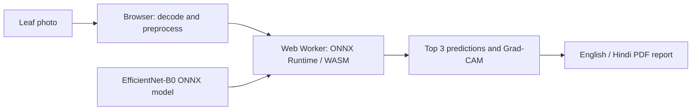

# AgriVisionAI

### Plant disease analysis, directly in your browser

[**Try the live demo →**](https://agrivision-ai-one-chi.vercel.app)

AgriVisionAI is a deployed plant-health project that combines machine learning with a responsive English/Hindi interface. Upload a leaf photo to explore the model's top three predictions, inspect a Grad-CAM heatmap, and download a report in your selected language.

The current model supports **14 crops and 38 crop–condition classes**. It is an educational decision-support demo, not a universal plant-disease diagnostic tool.

## Features

- **Local inference:** photos are processed on the visitor's device using ONNX Runtime Web; no image-upload API is required.
- **Top three predictions:** ranked model confidence scores, with uncertainty messaging.
- **Visual explanations:** compare the original image with a Grad-CAM attention overlay.
- **English and Hindi:** localized interface and downloadable PDF reports, including Hindi text shaping.
- **Image handling:** JPEG, PNG, and WebP support, orientation correction, upload limits, and basic image-quality warnings.
- **Static deployment:** hosted on Vercel with no prediction server to keep running.

## Architecture



Python and PyTorch are used for model development and export. The deployed React application runs inference in a Web Worker and creates reports locally. Vercel serves the application and model assets; uploaded photos are not sent to an inference server.

## Technology stack

| Area | Tools |
| --- | --- |
| Interface | React, Vite, Tailwind CSS |
| Model development | Python, PyTorch, EfficientNet-B0 |
| Browser inference | ONNX Runtime Web, WebAssembly, Web Workers |
| Explainability | Grad-CAM |
| Reports | jsPDF, Canvas, Noto Devanagari font |
| Deployment | Vercel |
| Optional research backend | FastAPI |

## Run locally

Use **Node.js 22.12+ or Node.js 24 LTS** and npm. Python is not needed to run the browser application.

```bash
git clone https://github.com/ananyasamal812-commit/AgriVisionAI.git
cd AgriVisionAI
npm --prefix frontend ci
npm run dev
```

Open the local URL printed by Vite. The browser model and its metadata are included. Runtime files are copied automatically from the installed ONNX Runtime package before development and production builds.

```bash
# Production build
npm run build

# Source checks
npm --prefix frontend run lint

# Preview the production build
npm --prefix frontend run preview
```

The first analysis downloads approximately **17.9 MB of model weights**, plus the WebAssembly runtime. Inference speed depends on the device. Photos and results are not persisted; download the report before refreshing.

## Deploy to Vercel

Import this repository into Vercel and configure:

| Setting | Value |
| --- | --- |
| Root directory | `frontend` |
| Framework | Vite |
| Build command | `npm run build` |
| Output directory | `dist` |

No API key or Python backend is required. Alternatively, run `npx vercel --prod --cwd frontend`. See [deployment details](DEPLOYMENT_BROWSER.md). Free hosting remains subject to platform usage limits.

## Model and evaluation

| Item | Current status |
| --- | --- |
| Architecture | EfficientNet-B0 |
| Model input | 128 × 128 RGB |
| Supported outputs | 38 conditions across 14 crops |
| Recorded checkpoint validation accuracy | 94.58%; used for checkpoint selection |
| Independent field-test accuracy | Not yet established |
| PyTorch → WebAssembly conversion check | Same leading prediction on all 15 checked images |
| Maximum confidence change from browser preprocessing | 0.36 percentage points on those checked images |

**Conversion agreement measures implementation consistency, not disease-recognition accuracy.** The recorded validation score is not evidence of performance on arbitrary internet or field photos.

Supported crops: apple, blueberry, cherry, corn, grape, orange, peach, bell pepper, potato, raspberry, soybean, squash, strawberry, and tomato. Exact labels are in [configs/classes.json](configs/classes.json).

### Limitations

- Unsupported plants and diseases can receive confident but incorrect predictions.
- Lighting, background, camera quality, and field conditions can affect results.
- Confidence scores are model scores, not calibrated probabilities of a correct diagnosis.
- Heatmaps show influential image regions, not disease severity or affected area.
- Treatment decisions should be confirmed by an agricultural expert.

## Repository structure

```text
frontend/
  src/                 React interface, inference worker, localization and PDFs
  public/model/        ONNX model and metadata
  public/fonts/        Hindi report font and license
  scripts/             Runtime setup and conversion/report checks
src/                   Python model, inference, training and optional API code
configs/               Class labels and training configuration
data/                  Condition descriptions and Hindi translations
tests/                 Python API, image-handling and localization tests
export_browser_model.py  PyTorch-to-ONNX export and comparison workflow
model_workflow.py       Candidate training, data audit and evaluation
prepare_field_dataset.py  Field-dataset preparation
```

## Training and reproducibility

The browser application is runnable from this repository. Original training images, local virtual environments, generated reports, and research candidate weights are excluded.

Retraining and re-exporting require a compatible PyTorch checkpoint and appropriately licensed data. The ONNX artifact supports inference; it does not include the optimizer or original training data. See [FIELD_TRAINING.md](FIELD_TRAINING.md) for the separate broader-data research workflow and [DEPLOYMENT_BROWSER.md](DEPLOYMENT_BROWSER.md) for export checks. Validation scripts require the fixtures generated by the exporter and are not standalone accuracy benchmarks.

## Roadmap

- Evaluate on an independent, source-separated field-image test set.
- Fine-tune a broader field-image candidate and compare per-class precision, recall, and F1.
- Improve unsupported-image handling and confidence calibration.
- Promote a candidate only after evaluating accuracy, model size, and browser performance.

The broader-data candidate has **not** replaced the deployed model.

## Attribution and usage

The project uses ONNX Runtime, PyTorch, EfficientNet, and the Noto fonts. Font license notices are included with the assets. Training datasets retain their respective terms; no dataset is redistributed here. See the field-training notes before using the broader research dataset or distributing derived artifacts. No blanket license grant is made for third-party datasets or model assets.
